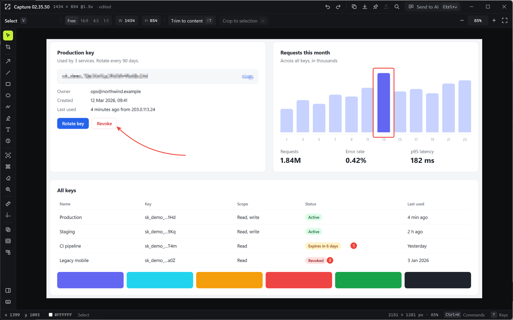
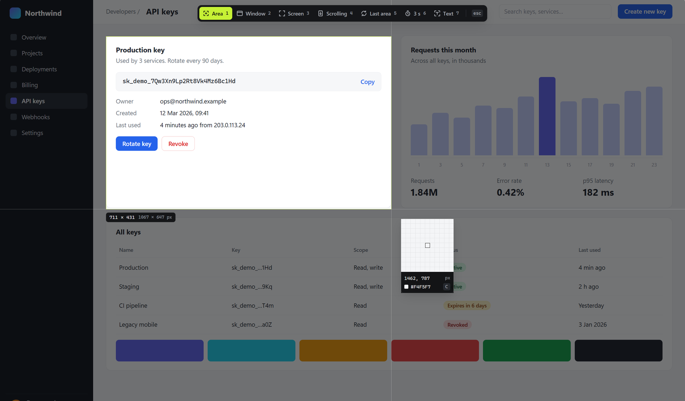
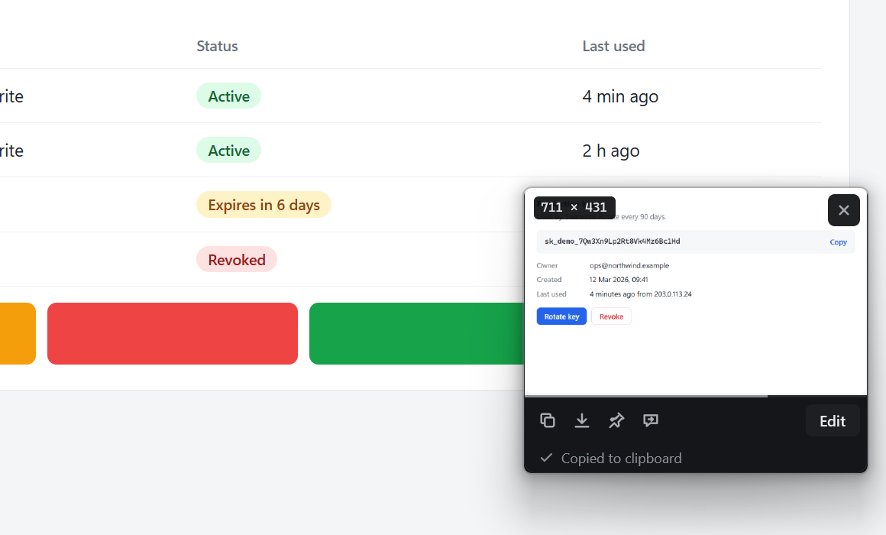
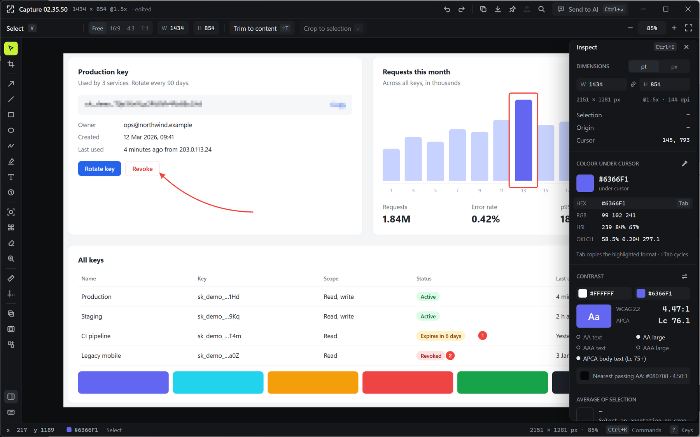

# Sukurin

A screenshot tool for people who count pixels: capture, inspect, measure, annotate, and hand off to a model. Rust and GPUI (through [gpui-kit](https://docs.rs/gpui-kit)). Windows is the first fully working platform; macOS and Linux compile against the same code with fallback backends that still need work (see Platform status).



## Install

macOS and Linux:

```bash
curl -fsSL https://raw.githubusercontent.com/voidwright07/sukurin/main/install.sh | sh
```

Windows (PowerShell):

```powershell
irm https://raw.githubusercontent.com/voidwright07/sukurin/main/install.ps1 | iex
```

The installer downloads the latest release, stops a running Sukurin, replaces it, and starts the new one. Run the same command again to upgrade. Set `SUKURIN_VERSION=v0.1.0` first to install a specific release.

| | Installs to | Also adds |
| --- | --- | --- |
| Windows | `%LOCALAPPDATA%\Programs\Sukurin\sukurin.exe` | Start Menu shortcut |
| macOS | `~/Applications/Sukurin.app` (or `/Applications` if it is already there) | |
| Linux x86_64 (glibc 2.39+: Ubuntu 24.04, Fedora 40, Debian 13 or newer) | `~/.local/bin/sukurin` | App menu entry and icon. If system libraries are missing it offers to install them with apt, dnf or pacman (asking for your password), and otherwise prints the command |

To uninstall, quit Sukurin from the tray and delete those files. Settings live in `%APPDATA%\Sukurin` on Windows and the platform config directory elsewhere.

On GNOME (Wayland), Sukurin's own global shortcuts do not fire, so bind one in GNOME instead: Settings, Keyboard, View and Customize Shortcuts, Custom Shortcuts, add a shortcut whose command is `~/.local/bin/sukurin --capture area` (with your home path spelled out) and give it a key such as `Super+Shift+S`. `--capture` also takes `window`, `screen`, `repeat` and `text`, and hands the request to the running Sukurin.

Releases are built by `.github/workflows/release.yml` when a `v*` tag is pushed. A tag with a `-` (for example `v0.2.0-rc.1`) becomes a prerelease, which the installers skip.

## Build from source

```bash
cargo run --release -p sukurin-app
```

The toolchain is pinned to Rust 1.98 in `rust-toolchain.toml` (gpui-kit 0.7.1 does not build on 1.92). Sukurin lives in the system tray; there is no main window. `sukurin --library` opens the Library on launch.

The first launch opens a short setup: pick the capture shortcut (`PrtSc`, `Ctrl+Shift+S`, or your own), see which shortcuts are free, and choose whether Sukurin starts when you sign in. Closing it at any step counts as done. `sukurin --onboarding` or **Run setup again** in Settings brings it back.

On Windows 11 22H2 and later, `PrtSc` opens Snipping Tool by default. Windows still lets Sukurin register the key, but the shell takes it first, so Sukurin reads the setting instead and leaves bare `PrtSc` unbound while it is on. Setup and Settings offer to switch it off: Sukurin writes `PrintScreenKeyForSnippingEnabled = 0` under `HKCU\Control Panel\Keyboard`, the same value as Windows Settings, Accessibility, Keyboard. Setup also notices when you change it in Windows Settings. If `PrtSc` still opens Snipping Tool afterwards, sign out of Windows and back in.

| Action | Windows / Linux | macOS (planned) |
| --- | --- | --- |
| Capture area (overlay) | `Ctrl+Shift+S`, `PrtSc` | `⌘⇧2` |
| Capture window | `Alt+PrtSc` | overlay key `2` |
| Capture screen | `Ctrl+PrtSc` | overlay key `3` |
| Repeat last area | `Ctrl+Shift+PrtSc` | `⌃⌘2` |
| Copy text from screen | `Alt+Shift+PrtSc` | `⌥⌘2` |
| Search existing screenshots (Library) | `Ctrl+Shift+K` | `⌘⇧K` |

Inside the overlay: `1`–`7` switch mode (area, window, screen, scrolling, last area, 3 s delay, text). Releasing a drag captures immediately; hold `Ctrl` while releasing to open the capture in the editor. A click without dragging captures the window under the cursor. `Z` toggles a pixel magnifier, `C` copies the colour under the cursor, `Esc` cancels. In Last area mode the previous region is shown with handles: adjust it, `Tab` applies the auto-adjust suggestion, `Enter` captures.

After a capture the image is already on the clipboard. The corner card offers Copy, Save (to `Pictures\Sukurin`), Pin, Send to AI, and drag-out: drag the preview into any app that accepts files. If the capture matches a screenshot you already have, the card says so and offers to open it instead.

Ctrl-releasing a drag in the overlay, Edit on the thumbnail, or double-clicking a Library tile opens the editor. Every tool has a single key (V select, C crop, A arrow, L line, R rectangle, O oval, P freehand, H highlighter, T text, N step, S spotlight, B blur/pixelate, E erase, Z magnifier, M measure, G guides, I image overlay, F backdrop), `Ctrl+K` opens the command palette, `Ctrl+I` the inspector (dimensions, colour formats with Tab-to-copy, WCAG and APCA contrast, average colour), and `Ctrl+C` / `Ctrl+S` / `Ctrl+P` copy, save and pin the exported image. The editor and the exporter draw from the same geometry, so the saved PNG matches the canvas.

Every global shortcut can be changed in **Settings…** (tray menu): click a shortcut, press the new keys, and it applies immediately. Settings live in `%APPDATA%\Sukurin\settings.json`.

## Screenshots

| | |
| --- | --- |
|  |  |
| Capture overlay with the pixel magnifier | Corner card after a capture |



## Layout

| Crate | Owns |
| --- | --- |
| `sukurin-core` | Shared types (`Bitmap` BGRA8, `RectPx`, `Shot`), auto-adjust trimming, area downscale, scroll stitching. No GUI. |
| `sukurin-library` | The index of screenshots already on disk: discovery per OS, perceptual matching, duplicate groups, SQLite store, thumbnails. No GUI. |
| `sukurin-annotate` | The annotation document and its single geometry pipeline (`Prim` polygons and image patches) plus tiny-skia export, so the editor shows exactly what is exported. |
| `sukurin-ui` | Design tokens, icons, small widgets shared by every window. |
| `sukurin-editor` | The editor window. |
| `sukurin-app` | The resident app: DXGI capture, tray, hotkeys, overlay, thumbnail, pin, OCR/QR toast, scrolling HUD, Library window, sharing. |

## Speed

Measured on a 2560x1600 HDR display at 150% (RTX 4080 laptop), release build:

- Hotkey to pixels: 7–14 ms with a persistent DXGI duplication session (GDI BitBlt was 44–52 ms, Windows Graphics Capture 29–36 ms).
- Hotkey to overlay drawn: about 30–45 ms.
- OCR of a 25-line region: about 155 ms (Windows.Media.Ocr).
- Duplicate lookup against the library: about 1.6 ms.

## Platform status

- **Windows:** everything above works and was driven end to end on a real desktop.
- **macOS, Linux:** capture falls back to `xcap` (slow path), there is no OCR engine wired, and drag-out and the multi-format AI clipboard are Windows-only. Both build in CI; macOS has not been run yet.
- **Linux specifics:** Sukurin starts on Wayland and X11 and its tray menu works (GNOME needs the AppIndicator extension, which Ubuntu enables by default). Capture from the tray menu or a GNOME custom shortcut running `sukurin --capture area` (see Install): Sukurin's global shortcuts are X11 key grabs, which GNOME on Wayland does not deliver, so the menu omits them there, and clicking the tray icon does not capture. The capture overlay opens fullscreen. On Wayland, capture goes through the desktop portal. Once GNOME has the screenshot permission for Sukurin it hands over the frame silently and Sukurin's overlay opens on it. GNOME only asks for that permission while a Sukurin window is in front, never for a tray click, so grant it once from Settings (tray icon, Settings, Allow screenshots, then Allow in GNOME's dialog); the setup window offers the same button. Without the permission GNOME's own screenshot picker takes the capture and the result goes straight to the thumbnail; Sukurin says so once per run. However it is launched, Sukurin moves itself into its own systemd scope at startup so GNOME attributes the permission to Sukurin rather than to the launcher or terminal that started it. Pins are not kept on top under GNOME.

## Diagnostics

- `RUST_LOG=info` (default) logs capture timings, thumbnail placement, saves, and pins.
- `SUKURIN_DUMP_SCROLL=<dir>` writes every scrolling-capture frame to `<dir>` for stitching analysis.
- `SUKURIN_AI_URL=<url>` overrides the chat Send to AI opens (chosen during setup: Claude, ChatGPT or Gemini; any non-http value opens nothing).
